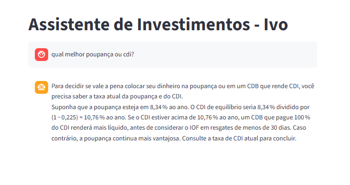

# Código da Aplicação

Esta pasta contém o código do seu agente financeiro.

## Estrutura Sugerida

```
src/
├── app.py              # Aplicação principal (Streamlit/Gradio)
├── agente.py           # Lógica do agente
├── config.py           # Configurações (API keys, etc.)
└── requirements.txt    # Dependências
```

## Exemplo de requirements.txt

```
streamlit
openai
python-dotenv
```

## Como Rodar

```bash
# Instalar dependências
pip install -r requirements.txt1. Baixe o Ollama
2. Baixe o GPT com o comando : ollama run gpt-oss
# Rodar a aplicação
streamlit run app.py
```
# Evidências

